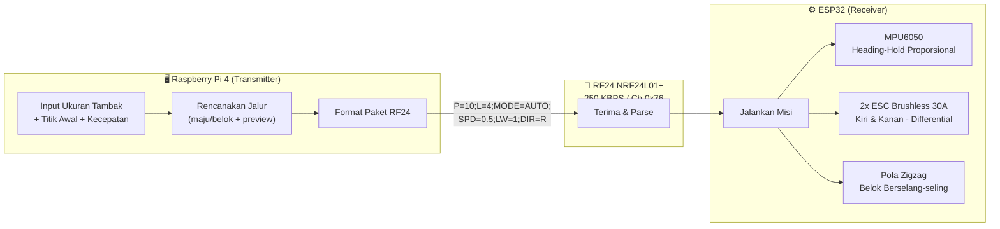
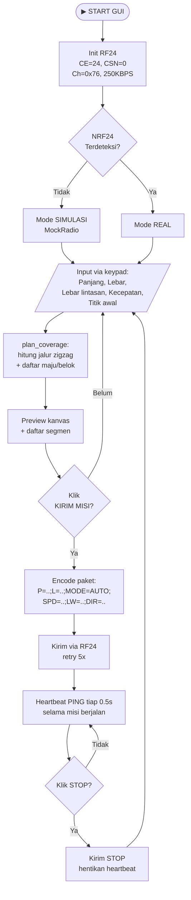
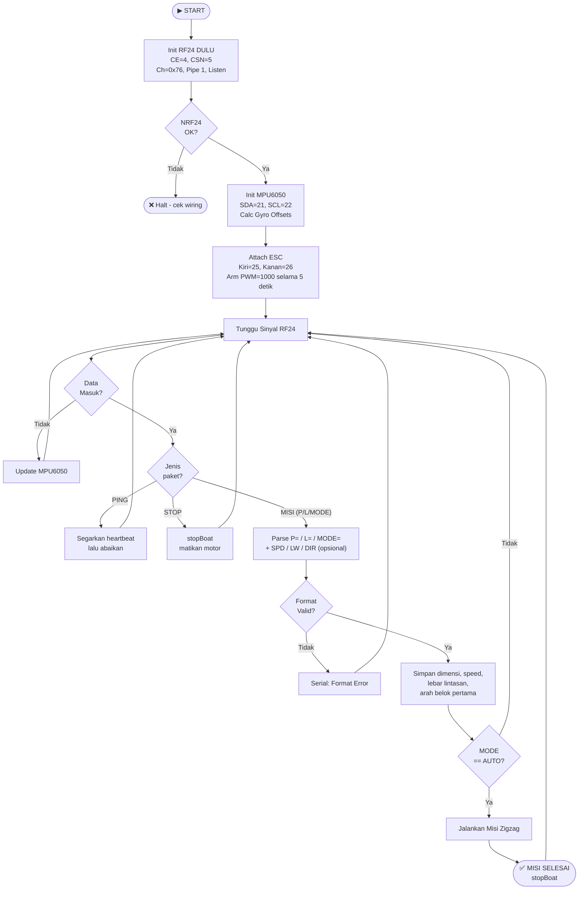
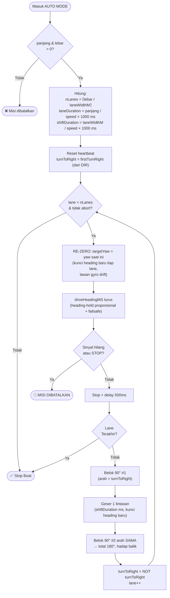
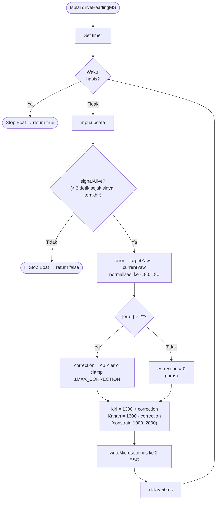
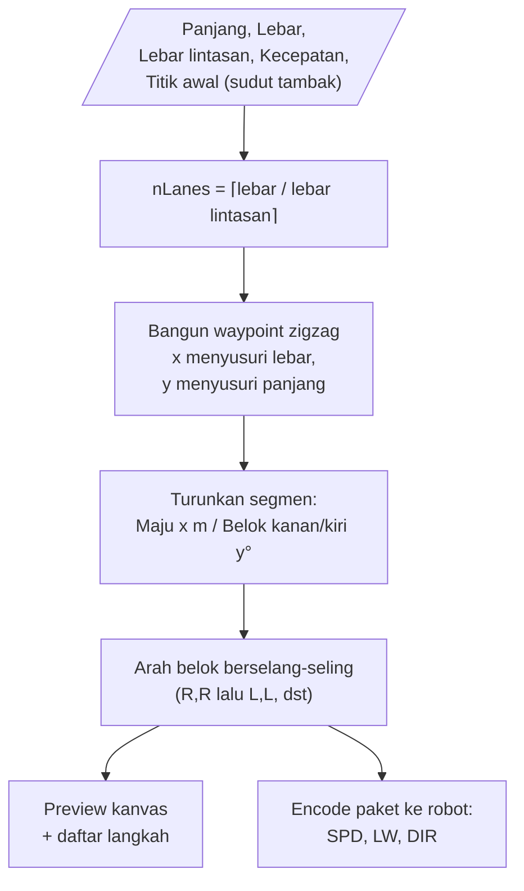

# Flowchart — Robot Akuatik Feeder Otomatis

> Render di VS Code: install extension **"Markdown Preview Mermaid Support"**, lalu Ctrl+Shift+V
>
> Versi PNG dari tiap diagram ada di folder **Flowchart Images/**.

---

## 1. Gambaran Sistem



---

## 2. Flowchart Raspberry Pi (Transmitter)

Alur aplikasi GUI (panel kontrol). Operasi penuh lewat **layar sentuh + keypad**, tanpa keyboard fisik.



---

## 3. Flowchart ESP32 (Receiver)



> Catatan: NRF di-init **paling awal** (sebelum MPU & ESC). MPU `calcGyroOffsets` dan `armESC` menahan beberapa detik; bila NRF telat listening, transmitter tak ter-ACK dan melaporkan gagal.

---

## 4. Flowchart Misi Zigzag (AUTO MODE)



> Catatan: arah U-turn **berselang-seling** (kanan-kanan, lalu kiri-kiri, dst) sehingga geseran selalu ke sisi yang sama — sapuan menutupi **seluruh** lebar tambak (boustrophedon). Versi sebelumnya selalu belok kanan sehingga hanya bolak-balik di dua kolom.

---

## 5. Logika Heading-Hold Proporsional (driveHeadingMS)



> Koreksi **proporsional** (`Kp × error`) menggantikan koreksi tetap ±20 — makin besar simpangan, makin kuat koreksi, sehingga gerak lurus lebih halus dan tidak zig-zag kecil.

---

## 6. Perencanaan Jalur (Path Planning)

Terjemahan tambak persegi menjadi path eksplisit di sisi aplikasi (fungsi `plan_coverage`).



---

## Pola Fisik Zigzag di Tambak

```
START
 │
 ▼
┌─────────────────────────────┐
│ →→→→→→→→→→→→ Lane 1         │
│                          ↓  │  U-turn (belok kanan ×2)
│ ←←←←←←←←←←←← Lane 2        │
│ ↓  U-turn (belok kiri ×2)   │
│ →→→→→→→→→→→→ Lane 3         │
│                          ↓  │  U-turn (belok kanan ×2)
│ ←←←←←←←←←←←← Lane 4   STOP│
└─────────────────────────────┘
     TAMBAK (panjang × lebar)
```

> Arah U-turn berganti tiap lane (kanan-kanan, lalu kiri-kiri, dst) agar geseran konsisten ke satu sisi dan menutupi seluruh lebar tambak.
