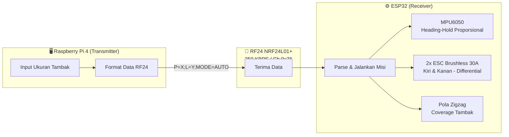
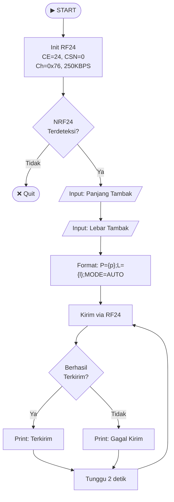
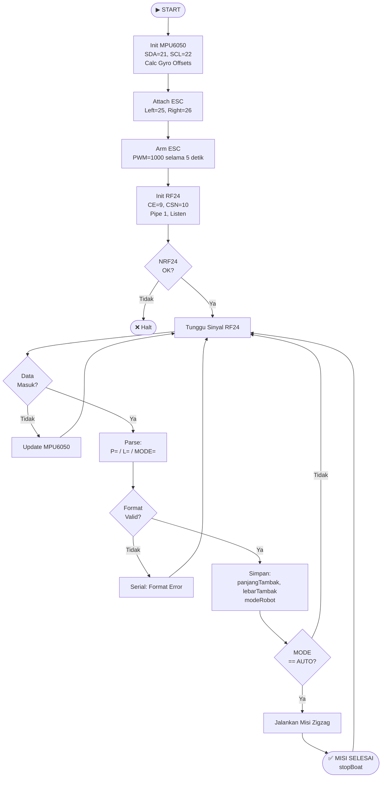
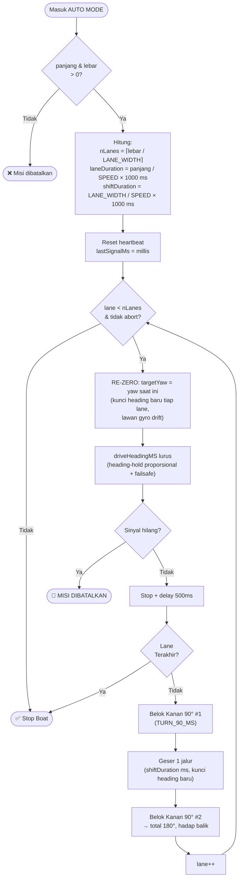
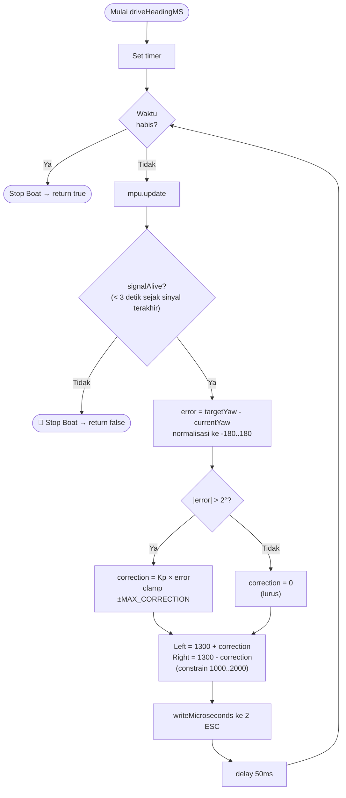

# Flowchart — Robot Akuatik Feeder Otomatis

> Render di VS Code: install extension **"Markdown Preview Mermaid Support"**, lalu Ctrl+Shift+V

---

## 1. Gambaran Sistem



---

## 2. Flowchart Raspberry Pi (Transmitter)



---

## 3. Flowchart ESP32 (Receiver)



---

## 4. Flowchart Misi Zigzag (AUTO MODE)



> Catatan: arah balik tiap lane dihasilkan dari **dua kali belok kanan 90°** (total 180°), bukan dari aritmetika yaw. Cocok dengan ESC unidirectional yang hanya bisa belok melingkar.

---

## 5. Logika Heading-Hold Proporsional (driveHeadingMS)



> Koreksi **proporsional** (`Kp × error`) menggantikan koreksi tetap ±20 — makin besar simpangan, makin kuat koreksi, sehingga gerak lurus lebih halus dan tidak zig-zag kecil.

---

## Pola Fisik Zigzag di Tambak

```
START
 │
 ▼
┌─────────────────────────────┐
│ →→→→→→→→→→→→ Lane 1         │
│                          ↓  │
│ ←←←←←←←←←←←← Lane 2        │
│ ↓                           │
│ →→→→→→→→→→→→ Lane 3         │
│                          ↓  │
│ ←←←←←←←←←←←← Lane 4   STOP│
└─────────────────────────────┘
     TAMBAK (panjang × lebar)
```
