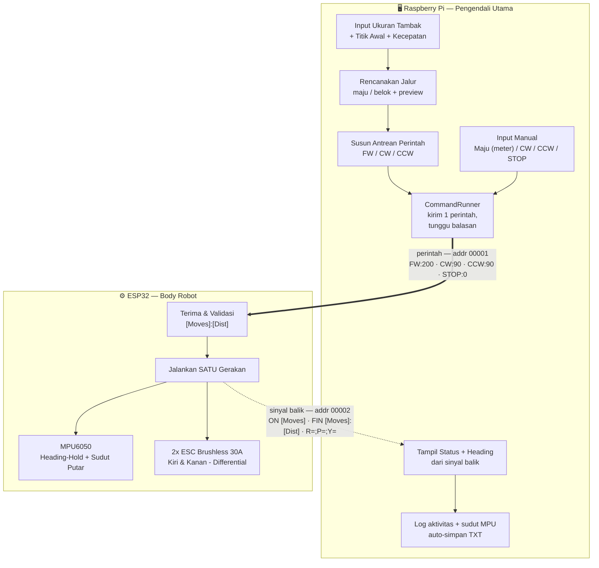
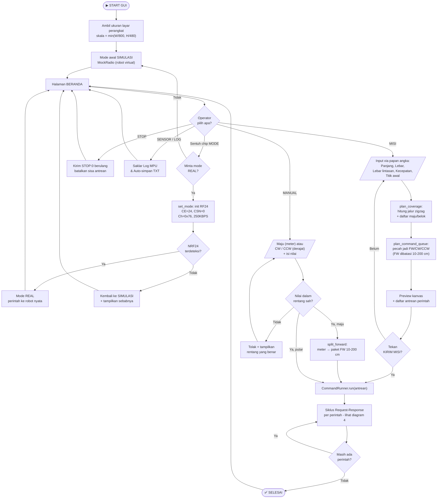
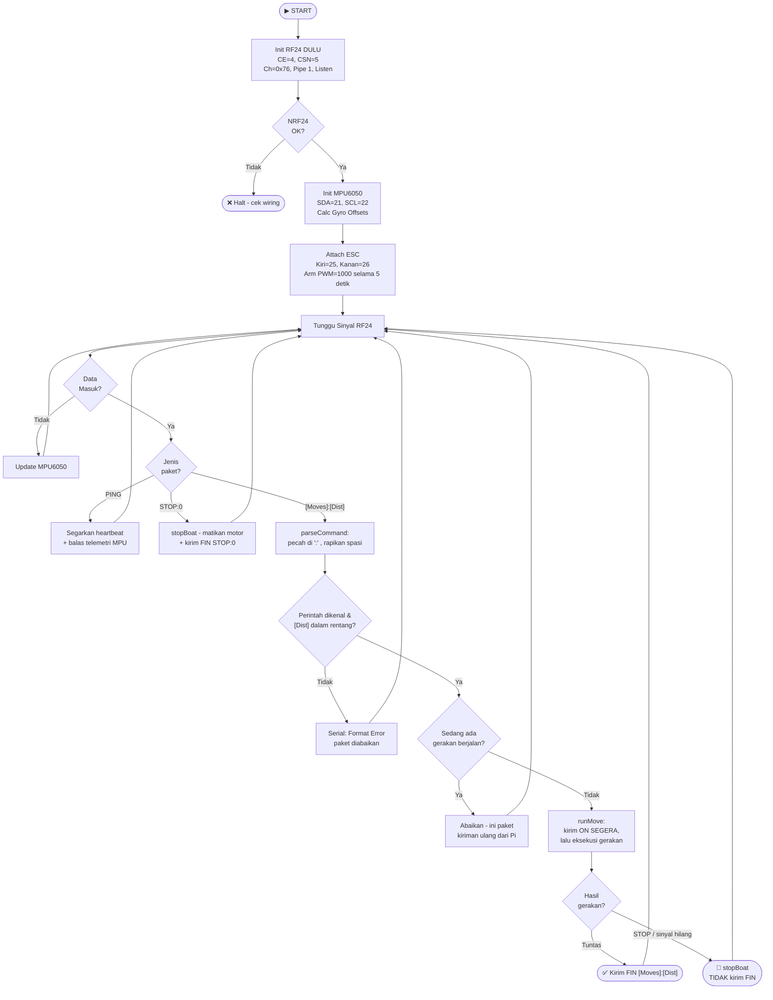
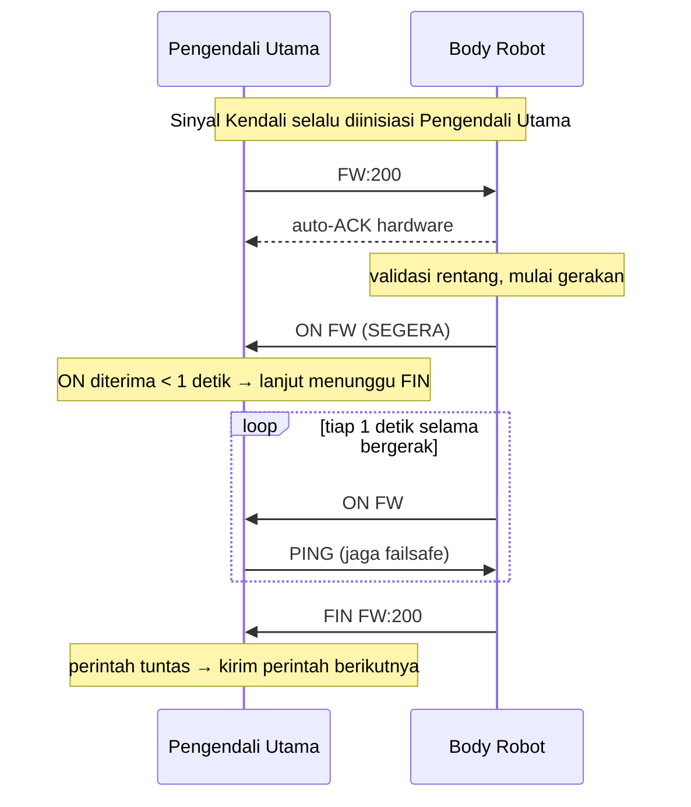
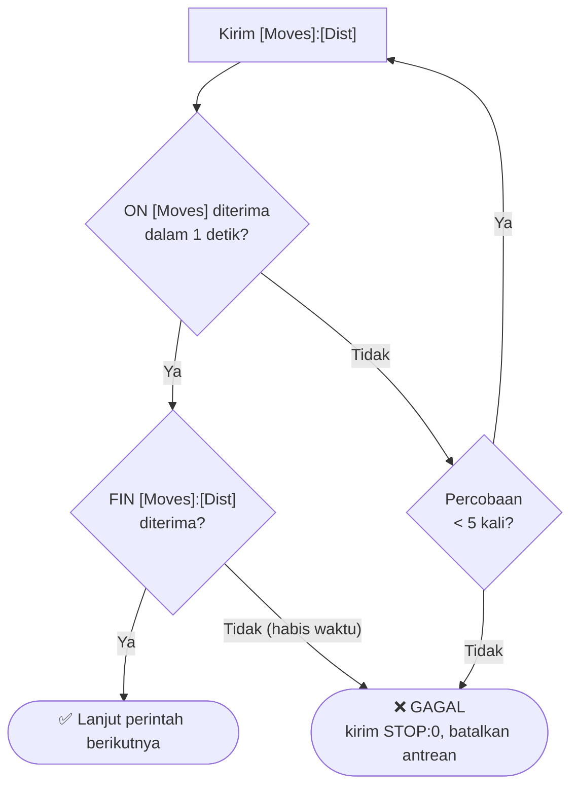
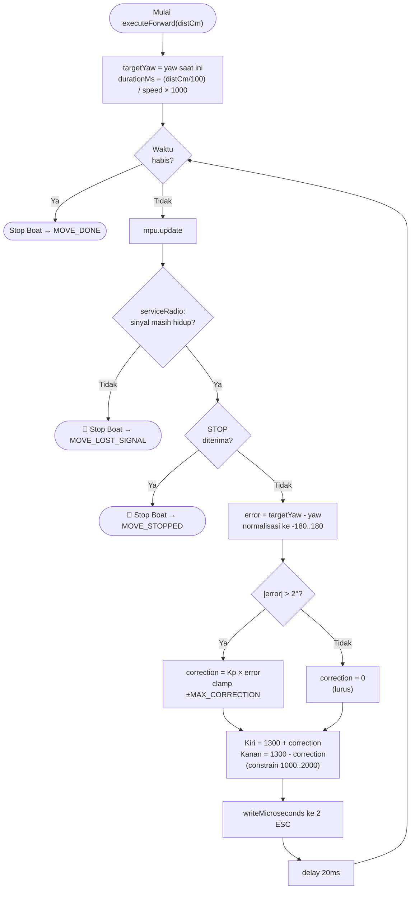
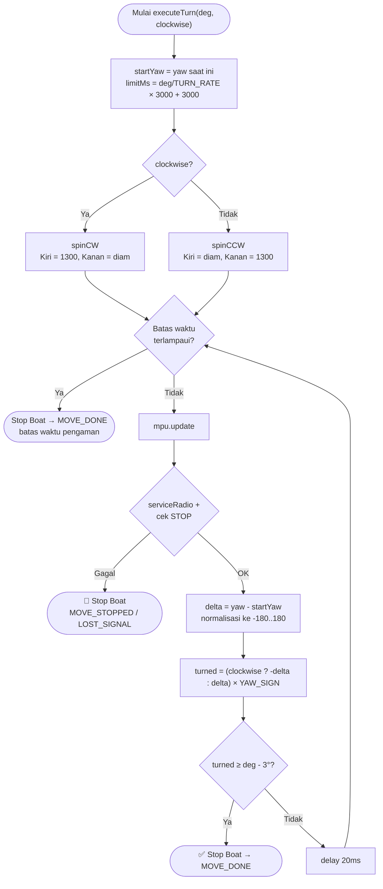
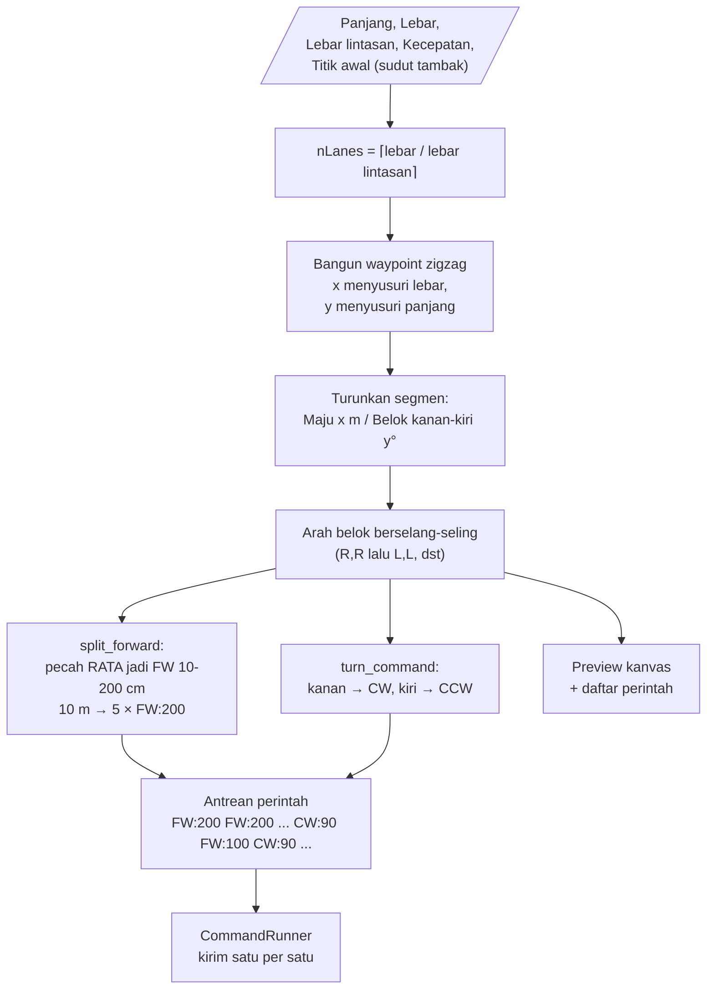
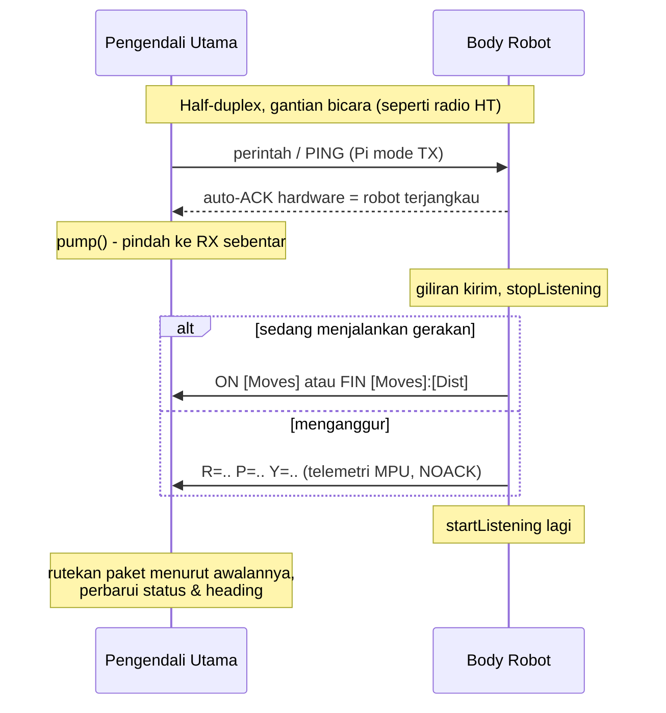

# Flowchart — Robot Akuatik Feeder Otomatis

> Render di VS Code: install extension **"Markdown Preview Mermaid Support"**, lalu Ctrl+Shift+V
>
> Versi PNG dari tiap diagram ada di folder **Flowchart Images/** (regenerate dengan `python render_flowcharts.py`).
>
> Protokol mengikuti **Dokumen Spesifikasi Teknis — Robot Akuatik untuk Tambak Ikan**, bab Skema Komunikasi.

---

## 1. Gambaran Sistem



> **Perubahan peran robot.** Pola zigzag kini disusun & dikemudikan Pengendali Utama; robot hanya eksekutor satu perintah. Mengubah pola jalur cukup di aplikasi, tanpa flash ulang ESP32.

---

## 2. Flowchart Pengendali Utama (Transmitter)

Alur aplikasi GUI. Operasi penuh lewat **layar sentuh** (papan angka di layar), tanpa keyboard fisik.



> Tombol **STOP** ada di bilah atas sehingga dapat ditekan dari halaman mana pun, termasuk saat antrean sedang berjalan.
>
> **Mode awal selalu SIMULASI**; perpindahan ke REAL adalah keputusan sadar operator lewat chip **MODE** (atau flag `--real`), dan ditolak selagi ada perintah berjalan. Sementara itu sudut MPU mengalir sendiri dari telemetri NRF di latar belakang — **tanpa port serial** — dan saklar **Log MPU** / **Auto-simpan TXT** menentukan apakah ikut dicatat ke berkas.

---

## 3. Flowchart Body Robot (Receiver)



> **NRF di-init paling awal** (sebelum MPU & ESC). `calcGyroOffsets` dan `armESC` menahan beberapa detik; bila NRF telat listening, Pengendali Utama tak ter-ACK dan melaporkan gagal.
>
> **Gerakan gagal sengaja tidak dilaporkan.** Tanpa `FIN`, Pengendali Utama tahu perintah tidak tuntas dan tidak melanjutkan ke perintah berikutnya.

---

## 4. Siklus Request-Response (Satu Perintah)

Inti protokol Sinyal Kendali. Setiap perintah dihitung sebagai satu paket komunikasi.



**Bila `ON` tidak datang dalam 1 detik:**



> Karena Pengendali Utama mengirim ulang saat `ON` telat, robot **mengabaikan perintah gerak baru selama masih sibuk** — kecuali `STOP`, yang selalu dilayani seketika. Tanpa aturan ini satu perintah bisa jadi beberapa gerakan.

---

## 5. Perintah FW — Heading-Hold Proporsional (`executeForward`)



> Koreksi **proporsional** (`Kp × error`): makin besar simpangan, makin kuat koreksi — gerak lurus lebih halus. *Deadband* 2° mencegah motor terus dikoreksi karena derau sensor.
>
> Tiap perintah `FW` **mengunci ulang** `targetYaw` dari pembacaan terbaru, sehingga *drift* giroskop tidak menumpuk lintas perintah.

---

## 6. Perintah CW / CCW — Putaran Closed-Loop Yaw (`executeTurn`)



> **Sudut ditutup oleh sensor, bukan oleh waktu.** Konstanta `TURN_90_MS` yang dulu rawan sudah dihapus; `TURN_RATE_DPS` kini hanya dipakai untuk menghitung batas waktu pengaman.
>
> ESC **unidirectional** → putaran memakai *differential thrust*, jadi robot berputar melingkar lebar (posisi ikut bergeser), bukan berputar di tempat. Sudut akhirnya tetap akurat.
>
> Kalau `CW` malah berputar ke kiri, tanda sumbu Z MPU terbalik → ubah `YAW_SIGN` menjadi `-1`.

---

## 7. Perencanaan Jalur → Antrean Perintah

Terjemahan tambak persegi menjadi daftar paket Sinyal Kendali, seluruhnya di sisi aplikasi.



> **Pemecahan dibuat RATA** agar tidak menyisakan potongan di bawah batas minimum. Contoh: 10,05 m menjadi 6 × 167 cm, bukan 5 × 200 cm + sisa 5 cm yang tak bisa diperintahkan.
>
> **Arah U-turn berselang-seling** (kanan-kanan lalu kiri-kiri, dst) sehingga geseran selalu ke sisi yang sama — sapuan menutupi seluruh lebar tambak (*boustrophedon*). Selalu belok kanan hanya menghasilkan bolak-balik di dua kolom.

---

## 8. Sinyal Balik & Telemetri (Half-Duplex "Gantian")

Komunikasi 2 arah di atas modul NRF24 yang **sama** — bergantian bicara seperti radio HT.



Semua paket balik memakai alamat `00002`, terpisah dari alamat perintah `00001`. `RadioLink._route_packet()` mengenalinya dari awalan:

| Awalan | Ditafsirkan sebagai |
|---|---|
| `FIN ` | Perintah selesai — izin lanjut ke perintah berikutnya |
| `ON ` | Perintah sedang dijalankan |
| `R=` | Telemetri sudut MPU |

> Telemetri MPU dikirim robot **hanya setelah ada paket masuk**, bukan tiap iterasi loop, supaya tidak bertabrakan dengan perintah yang sedang dikirim Pengendali Utama. Semuanya **NOACK** (*fire-and-forget*) agar robot tak nge-*block*.

---

## Pola Fisik Zigzag di Tambak

```
START
 │
 ▼
┌─────────────────────────────┐
│ →→→→→→→→→→→→ Lane 1         │
│                          ↓  │  U-turn (CW:90 ×2)
│ ←←←←←←←←←←←← Lane 2        │
│ ↓  U-turn (CCW:90 ×2)       │
│ →→→→→→→→→→→→ Lane 3         │
│                          ↓  │  U-turn (CW:90 ×2)
│ ←←←←←←←←←←←← Lane 4   STOP│
└─────────────────────────────┘
     TAMBAK (panjang × lebar)
```

Contoh nyata — tambak **10 × 4 m**, lebar lintasan 1 m, mulai Kiri-Bawah → 4 lintasan, **29 perintah**:

```
FW:200  FW:200  FW:200  FW:200  FW:200      Lane 1 (10 m dipecah 5x)
CW:90   FW:100  CW:90                        U-turn kanan + geser 1 m
FW:200  FW:200  FW:200  FW:200  FW:200      Lane 2
CCW:90  FW:100  CCW:90                       U-turn kiri + geser 1 m
...                                          dst hingga Lane 4
```

> Arah U-turn berganti tiap lane agar geseran konsisten ke satu sisi dan menutupi seluruh lebar tambak.
